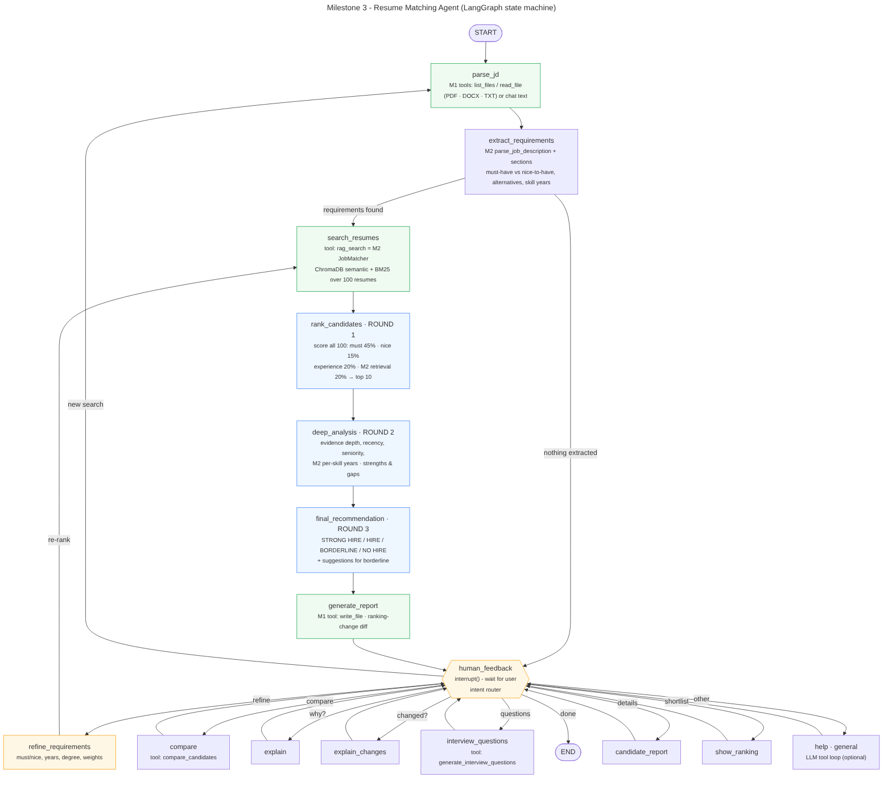

# Milestone 3: Intelligent Matching Agent (LangGraph)

A conversational hiring agent built on the two earlier milestones. It reads a job description, works out the must-haves and nice-to-haves, and screens **100 resumes in three rounds**. It writes an explainable report and then stays in a human-in-the-loop chat, where you can refine requirements, compare candidates, ask why one ranks above another, and get interview questions.

| Milestone | Code it contributes to the agent |
|---|---|
| **1: File System Assistant** | `milestone1/fs_tools.py` (copied unchanged): `list_files`, `read_file` (PDF/DOCX/TXT), `search_in_file` and `write_file`, which return errors as data. The agent uses them to load JDs and resumes and to write reports. An optional LLM can call them through the same function-calling loop as M1. |
| **2: Resume RAG** | `api/`: `parse_job_description`, `extract_metadata` (years from merged date ranges, per-skill years, degree), `split_sections`, the skills taxonomy, `ResumeRAG` (ChromaDB) and `JobMatcher.match` (hybrid semantic + BM25). The agent's `rag_search` tool *is* M2's matcher. |
| **3: This milestone** | `matching_agent.py` (LangGraph graph) plus `agent/` (requirements, scoring rounds, explanations, NLU, tools), `chat_cli.py`, `app_streamlit.py`, tests, docs |



## Quick start

```bash
pip install -r requirements.txt
python scripts/build_m3_corpus.py        # 100 resumes: M2's 36 + 62 from M2's generator + John & Jane
python chat_cli.py --trace               # CLI chat; --trace prints reasoning + every tool call
streamlit run app_streamlit.py           # web chat with "Agent state" and "Reasoning & tools" tabs
pytest -q tests/test_m3_agent.py         # 8 conversation flows + integration tests (~10 s, offline)
python scripts/run_scenarios.py          # transcripts of the scripted flows -> docs/m3/transcripts/
python scripts/evaluate_m3.py            # M3 vs M2 ranking quality -> outputs/m3_metrics.json
python scripts/draw_graph.py             # re-export the state-machine diagrams
```

The first run indexes `data/resumes_m3/` into `vector_db_m3/` with M2's `ResumeRAG`. That takes about 6 s with the offline `local` embedder, and `vector_db/` (M2's index) is left untouched. To use a neural embedder as in M2, set `M3_EMBEDDING_PROVIDER=huggingface`. No API key is needed. Setting `LLM_PROVIDER=openrouter` with M1's `OPENROUTER_API_KEY` turns on optional LLM extraction, routing and free-form Q&A. Scores never come from the LLM.

## Part A: Agent architecture (40%)

**State (`AgentState` in `matching_agent.py`)**

| Concern | Fields |
|---|---|
| Conversation history | `messages` (`add_messages` reducer), `intent`, `turn` |
| Job requirements understanding | `jd_text`, `jd_source`, `requirements` (must/nice, alternatives, weights, per-skill years, min years, min degree), `weights`, `filters`, `change_log` |
| Candidate shortlist + reasoning | `retrieved` (M2 hits), `all_scores` (round-1 breakdown for **every** resume), `ranked_ids`, `shortlist` (round 2/3 evidence, strengths, gaps, decision, rationale, suggestions), `previous_shortlist`, `ranking_changes`, `report_path` |
| Audit trail | `reasoning`, `tool_trace` (append-only; shown by `--trace` and in Streamlit) |

**Workflow:** `START → parse_jd → extract_requirements → search_resumes → rank_candidates (R1) → deep_analysis (R2) → final_recommendation (R3) → generate_report → human_feedback ⟲ → END`

- `human_feedback` pauses with `interrupt()`. The UI resumes it with `Command(resume=text)`, and a `MemorySaver` checkpointer keeps state per thread.
- A router sends each turn to one of: `refine_requirements` (loops back to `search_resumes` to re-rank), `parse_jd` (new search), `compare`, `explain`, `explain_changes`, `interview_questions`, `candidate_report`, `show_ranking`, `help`, `general`, or `END`.
- `langgraph.json` lets you open the graph in LangGraph Studio (`langgraph dev`).

**Tools**

| Tool | Source |
|---|---|
| `list_files`, `read_file`, `search_in_file`, `write_file` | Milestone 1 (sandboxed to `data/` and `outputs/`) |
| `rag_search(query)` | Milestone 2 `JobMatcher.match`: semantic, keyword, M2's 0-100 score, excerpts |
| `extract_requirements(jd)` | M2's `parse_job_description` plus section awareness (Requirements vs Responsibilities), alternatives ("PyTorch or TensorFlow", "Redux or similar"), inline "a plus", soft asks ("familiarity with") → nice-to-have, and per-skill years from M2 ("4+ years Java") |
| `compare_candidates(candidate_ids)` | Head-to-head requirement matrix and verdict |
| `generate_interview_questions(candidate_id)` | Depth checks, verification of listed-but-unproven skills, gap probes, a skill-years check, a quantified-claim check, and a seniority question |

## Part B: Interactive features (30%)

- **Natural language:** "Find me candidates with React and 3+ years experience", "Compare the top 3 matches side by side", "Why did John rank higher than Jane?"
- **References:** by name ("John", "Zara Rahimi"), by position ("#2", "top 3"), or by resume id ("noah_aziz").
- **Iterative refinement:** "make Next.js a must-have", "TypeScript is only a nice to have", "remove HTML/CSS", "require 5+ years", "only Master's or higher" (filters on M2's degree metadata), "any degree", "prioritize experience". After each change the agent re-runs retrieval and all three rounds, then explains every move. For example: *Ifeoma Iyer #4 → #9: experience fit −10.7 pts (3 yrs)*. Asking "what changed?" later shows the diff again.

## Part C: Advanced capabilities (30%)

| Round | What happens |
|---|---|
| **1: Initial screen** (100 → 10) | 45% weighted must-have coverage, 15% nice-to-have, 20% experience fit, 20% M2 retrieval (semantic + BM25). Evidence strength is graded: listed and used in a role = 1.0, listed only = 0.8, used only = 0.75, implied (MySQL ⇒ SQL) = 0.55. |
| **2: Deep analysis** (top 10) | Evidence depth, recency (used in the current role), seniority (title, led/owned/mentored, quantified impact), and **M2 per-skill years against the JD** (a limitation M2 listed but didn't enforce). Produces strengths and gaps. |
| **3: Recommendation** | STRONG HIRE ≥ 85 and HIRE ≥ 72 require every must-have and the experience bar. BORDERLINE ≥ 58 allows one missing must-have or being under the bar, and comes with **improvement suggestions**. Everything else is NO HIRE. The final order is decision tier, then deep score. |

Each turn writes a **match report** to `outputs/m3_reports/`. It contains the requirements, the scoring model, a round-1 table with M2's baseline score, and a per-candidate evidence matrix that quotes the resume line behind each match, plus M2's RAG excerpts.

### Does the agent rank better than M2 alone?

`scripts/evaluate_m3.py` scores the top 10 from 100 resumes on the 6 M2 JDs against graded labels built with M2's relevance rule (2 = right role and senior enough, 1 = right role but junior):

| System | P@10 | R-Prec | nDCG@10 |
|---|---|---|---|
| M2 hybrid | 0.733 | 0.835 | 0.970 |
| M2 hybrid + must-have filter | 0.767 | 1.000 | 0.947 |
| M3 round 1 | 0.767 | 0.951 | 0.989 |
| **M3 final (round 3)** | **0.767** | **1.000** | **1.000** |

P@10 is capped below 1 because some JDs have fewer than 10 senior right-role resumes. M3 matches the filtered M2's R-Prec without removing anyone, which is why it can still explain candidates who didn't make the cut.

## Submission checklist

| Requirement | Where |
|---|---|
| LangGraph-based agent | `matching_agent.py`, `agent/` |
| State machine diagram | `docs/m3/state_machine.png` (annotated), `docs/m3/state_machine_generated.png` (exported from the compiled graph) |
| Chat interface | `chat_cli.py` (CLI) and `app_streamlit.py` (Streamlit) |
| 5+ conversation flows | `tests/test_m3_agent.py` (8 asserted flows), `tests/scenarios/*.txt`, transcripts in `docs/m3/transcripts/` |
| Demo video (5-6 min) | script: `docs/m3/DEMO_SCRIPT.md`; hands-free replay: `python chat_cli.py --trace --script tests/scenarios/demo.txt --delay 3` |
